# Lift display — ESP32 3.5" CAN-bus elevator indicator

A landscape 480×320 lift indicator and call panel on the **ESP32-3248S035R**
(3.5" ST7796, XPT2046 resistive touch). It listens to the lift controller's CAN
bus, shows the floor, direction and door full-screen with the time and the
weather, sends **car / hall calls and door open / close / hold** the way the real
buttons do, and connects to **MQTT / Home Assistant** (and through it Apple
HomeKit). Built for — and decoded on — a Fuji lift whose hall-call bus runs CAN
at the non-standard **27.78 kbit/s**; any other CAN lift can be learned with the
built-in debugger and logic analyzer.

<p>
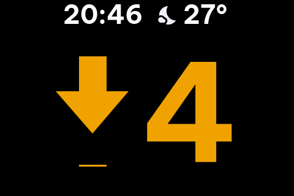 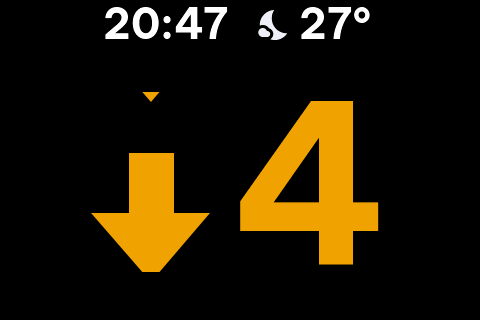 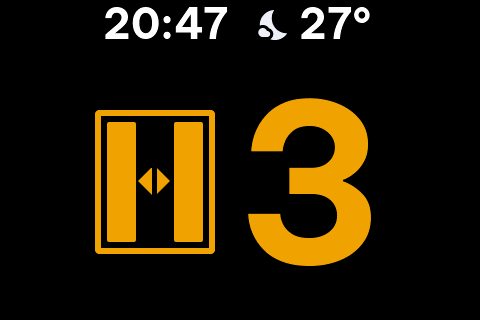
</p>

*Idle · moving down (the arrow scrolls) · stopped with the door open (the leaves slide open on a loop). Clock, weather icon and temperature in the top row.*

All panel images in this README are read back from the real display's memory
(`GET /api/screen`, or the `shot` console command over USB), not mock-ups.

## Highlights

- **Full-screen indicator** — 220 px floor number in gold, scrolling arrow,
  animated door pictogram, clock + weather (Open-Meteo) in the top row; status
  text only when something is wrong (no signal, fire service, fault, inspection,
  out of service, overload).
- **Fuji protocol decoded on site** — floor, direction, running, door, the three
  call registers, lanterns, door buttons ([details](#fuji-hall-call-bus--the-default-map)).
  Car and hall calls and door open / close / hold sent and confirmed on the lift.
- **Any other lift** — a protocol map (ID · byte · mask) learnt from the panel or
  the web debugger; CiA 417 (CANopen-Lift) decoder and the project's EVL-CAN built in.
- **Web CAN debugger** at `/debug` — live frames by ID with change highlighting
  and decoded meaning, recorder with markers (.log / .csv), raw send, bit-rate
  detection, a **logic analyzer** on the RX pin that finds non-standard rates and
  decodes every burst as CAN or UART, and the CAN controller's own error report.
- **Safe on the bus** — listen-only first (made truly silent despite an ESP32
  errata), ACK only after 20 clean frames, automatic fallback and bus-off guard,
  calls refused in fire service / inspection / fault / while moving.
- **Built to run 24/7** — loop watchdog, reset reason in the event log, WiFi that
  never gets stuck in AP mode, automatic CAN re-arm, memory guard, flash-wear-aware log.
- **Network** — status page, settings page (technician code), firmware update
  over WiFi, MQTT with Home Assistant discovery, audio announcements over HTTP.

<p>
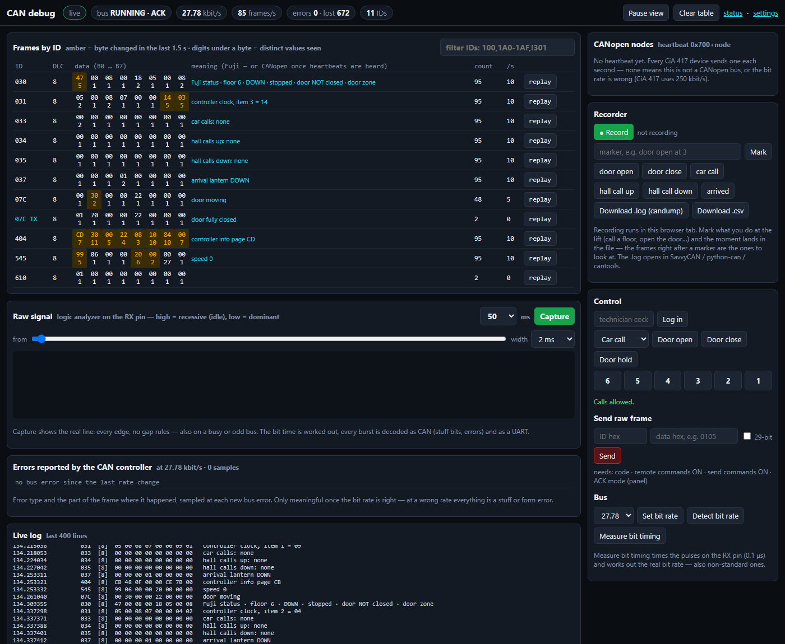
</p>

*The CAN debugger on the Fuji bus: every ID with its bytes, change highlighting and the decoded meaning.*

## Status

| Item | Status |
|---|---|
| Firmware (PlatformIO, Arduino-ESP32 2.0.17, LVGL 8.4) — RAM 32 %, flash 84 % of one OTA slot | ✅ builds, runs on the board |
| Fuji hall-call bus, 27.78 kbit/s: floor, arrows, running, door, call registers | ✅ verified on the lift (trips 1↔6, every call type) |
| Car calls, hall calls, door open / close / hold sent from the panel, web, Home Assistant | ✅ car calls and door commands confirmed on the lift; hall calls built the same way |
| CAN driver: listen-only first, arming, fallback, bus-off guard, automatic re-arm | ✅ on the real bus (0 errors at 27.78k) |
| Web pages `/`, `/cfg`, `/debug`, firmware update over WiFi | ✅ used daily during the install |
| Weather (Open-Meteo), clock (NTP) | ✅ |
| 24/7 guards (watchdog, WiFi retry + AP off, memory guard, reset reasons) | ✅ in the firmware; long-term run in progress |
| Fire service, inspection, fault code, load on the Fuji bus | ⬜ not identified yet — needs the lift in those modes |
| MQTT + Home Assistant discovery | ⚠️ written, not yet tested against a broker ([guide](docs/home-assistant-homekit.md)) |
| Audio announcements (HTTP port 81, I2S DAC) | ⚠️ speaker test runs; network playback not yet tested |
| CiA 417 (CANopen-Lift) decoder | ⚠️ tested with the built-in simulator only |
| Enclosure | ⬜ not designed |

## Hardware

| Part | Notes |
|---|---|
| ESP32-3248S035R | 3.5" 480×320, resistive touch. Same board as esp32Fire |
| 3.3 V CAN transceiver | **SN65HVD230** module for the bench. On a real lift use an **isolated** one (e.g. Mornsun TD321DCANH, ADM3053, CA-IS3050) — VFDs and long runs put volts between grounds. **Not TJA1050**: it runs at 5 V and drives 5 V into GPIO 35 |
| 10 kΩ resistor | GPIO 22 → 3V3 (see below) |
| Power | 5 V on the USB / P1 connector. From the lift's 24 V use an isolated DC-DC — never feed the board from the controller directly |

The ESP32 already contains a CAN 2.0B controller (Espressif calls it TWAI);
only the physical transceiver is missing.

### Wiring — no soldering on the board (connector CN1)

| SN65HVD230 ("VP230") module | Board | |
|---|---|---|
| 3V3 | CN1 · 3V3 | |
| GND | CN1 · GND | |
| CTX (D, driver input) | **CN1 · GPIO 21** | + **10 kΩ pull-up to 3V3** |
| CRX (R, receiver output) | **CN1 · GPIO 22** | |
| CANH / CANL | lift CAN bus | twisted pair |

- **Why the pull-up on TX:** between ESP32 reset and the moment the driver
  takes the pin, GPIO 21 floats. The SN65HVD230 has no pull-up on D and no
  dominant time-out; D drifting low holds the **whole lift bus dominant** and
  every other node goes silent. The firmware also drives the pin high as the
  very first thing in `setup()` and whenever the driver is removed.
- **Termination:** 120 Ω only at the two physical ends of the bus. Most
  SN65HVD230 boards have a 120 Ω resistor fitted — remove it when the display
  taps into the middle of an existing bus.
- **A board that ran esp32Fire:** GPIO 35 was the CC1101's GDO0 and GPIO 21/22
  the I2C bus (PCF8574 relays, DS3231). Remove those modules before connecting
  a CAN transceiver.

Pin use: display HSPI 14/12/13/15/2, backlight 27 · touch CS 33, IRQ 36 ·
CAN TX 21 / RX 22 · RGB LED 4/16/17 · speaker 26 (DAC2) · light sensor 34 ·
GPIO 35 spare, input only (reserved for a dry-contact input such as a fire-alarm signal).

## Safety design — the display must never disturb the lift

A CAN node configured wrongly (wrong bit rate, say) and running in normal mode
sends **error frames** into every frame it cannot decode. Lift controllers
treat communication errors as a fault and stop the car. A display plugged in
wrong can trap people in a car. Hence:

1. **Listen-only first.** After every boot or rate change: no ACK, no error
   frames, no transmission — electrically invisible on the bus. ACK mode,
   sending commands and remote commands are **on by default** since the
   Fuji install (asked for on site); each can be switched off on the panel.
2. **ACK mode arms itself carefully.** Even when enabled it starts in
   listen-only and only switches to normal mode after **20 valid frames with
   almost no bus errors**. At a wrong bit rate it never hears a valid frame,
   so it never starts acknowledging.
3. **Automatic fallback.** More than 20 bus errors/s for 3 seconds in ACK mode
   → back to listen-only, logged. The same when sending fails until **bus-off
   three times within a minute** (a loose CTX wire did exactly that on site):
   the queue is dropped and the display stops trying instead of failing forever.
   For unattended 24/7 running it **re-arms by itself** after a quiet wait —
   10 min, doubled after every fallback that follows a re-arm within the hour
   (max 8 h), back to 10 min after a clean day — and arming still starts
   listen-only and needs 20 clean frames. RETRY ACK on the panel re-arms at once.
4. **Bit-rate detection runs in listen-only only** (25 k … 1 Mbit/s, ~6 s).
5. **Sending commands** is a separate switch from ACK.
   Even when on, every command is refused during **fire service, inspection,
   out of service, a fault, or loss of signal**; at most one command per
   300 ms; top floor has no hall-up, bottom floor no hall-down.
6. **Only calls and door open/close** — the same things a passenger can press.
   No drive, no door-bypass, nothing in the safety chain.
7. **Remote commands (web + Home Assistant) are a third switch** (panel, or `/cfg` behind the technician code).
   While it is off the control entities are **removed** from Home Assistant
   instead of being left as buttons that are always refused.
8. Enabling ACK, enabling commands and enabling remote commands each ask for
   confirmation on the panel; none of them can be changed from the web page.

> This is a monitoring and call terminal, not a safety component. Connecting
> anything to a lift's control bus must be done with the lift's maintenance
> contractor and within local lift regulations.

## Using the panel

**Main screen** — the whole panel is the indicator. The slot left of the floor
number shows the scrolling direction arrow while the car moves (static arrow =
next direction), and a green **doors-open pictogram** while it stands with the
door open. Three small icons top-right: **call panel · event log · menu**.
In **display-only mode** (MENU › DISPLAY) the icons are hidden; hold the screen
for 2.5 s to open the menu.

Fire service, fault, inspection, out of service, overload and loss of signal
switch to an **incident layout**: the floor number shrinks and the bottom
third becomes a banner with a 42 px title (fire service flashes red at 1 Hz).

Incident layouts (captured on an earlier build — the top row now shows the clock and weather):

| | | |
|---|---|---|
| 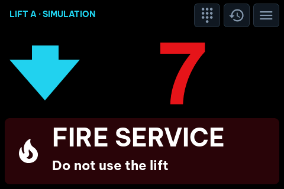 | 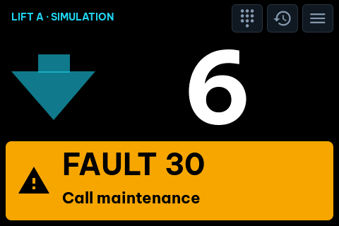 | 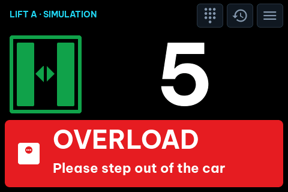 |
| 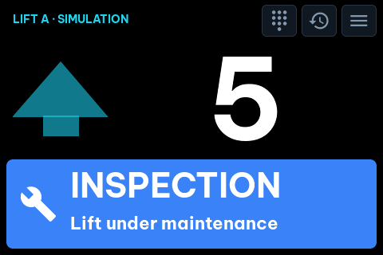 | 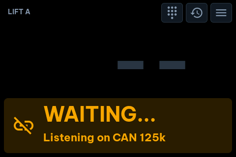 | |

The other screens (current firmware):

| | | |
|---|---|---|
| 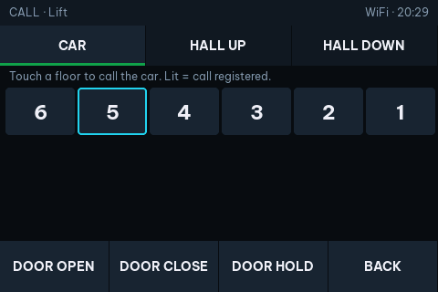<br>CALL — car / hall up / hall down, door open · close · hold | 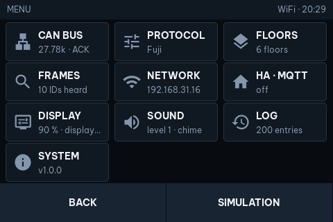<br>MENU | 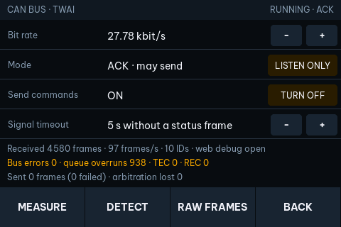<br>CAN BUS — rate, mode, MEASURE / DETECT |
| 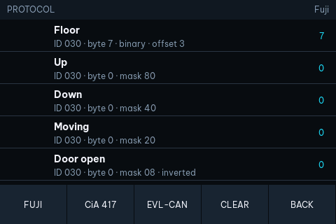<br>PROTOCOL — FUJI / CiA 417 / EVL-CAN | 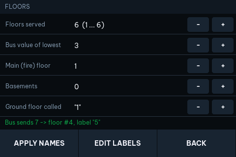<br>FLOORS | 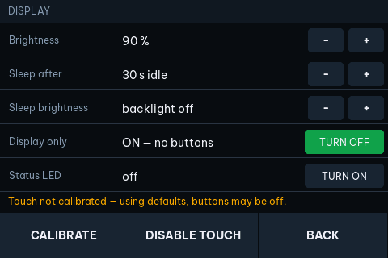<br>DISPLAY — sleep, brightness, touch off |
| 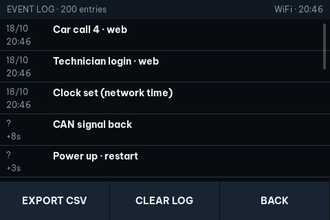<br>LOG | 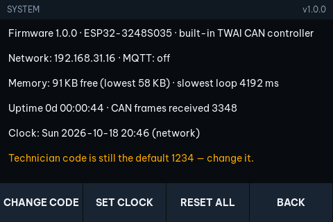<br>SYSTEM | 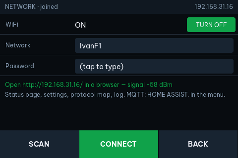<br>NETWORK |
| 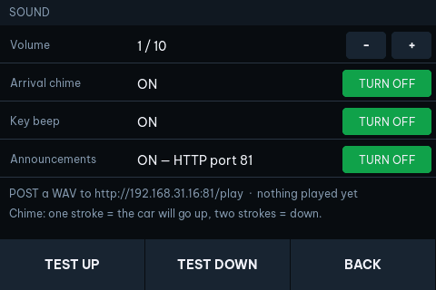<br>SOUND | 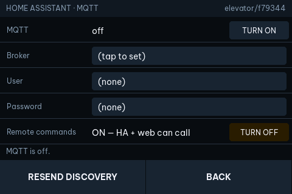<br>HA · MQTT | 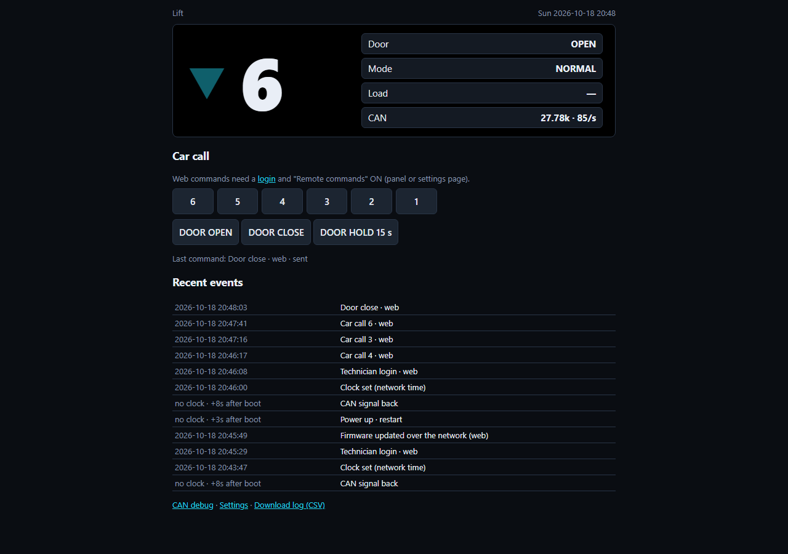<br>web status page |

- **Call panel:** CAR / HALL UP / HALL DOWN tabs, highest floor first, lit
  buttons = registered calls (from the call bitmaps), outlined = current floor.
  The line under the tabs says exactly why calls are locked when they are.
- **Settings on the panel need no code.** The technician code (default 1234,
  change it in MENU › SYSTEM) now only locks the web settings page, which
  anyone on the network can reach.
- Untouched screens return to the indicator after 60 s (10 minutes on the
  diagnostic screens, 3 on the keyboard). Fire service always takes the screen.
- The arrival chime follows the hall-lantern convention: **one stroke = the car
  will go up, two strokes = down.**
- **Auto-sleep:** the backlight goes **off after 30 s** untouched (MENU › DISPLAY:
  sleep after / sleep brightness). The first touch only wakes the screen — it
  never presses the button under the finger. Lift activity wakes it too: a
  floor change, an arrival, a mode change (fault, fire service…), an
  announcement. Fire service keeps it on at full brightness.
- The floor number and the arrow / door pictogram are centred as one group; with
  no icon the number alone is centred.
- The on-board RGB status LED is **off** by default (MENU › DISPLAY › Status LED).

## Web CAN debugger — `http://<ip>/debug`

For capturing an unknown lift bus from a laptop or phone (the board on site WiFi,
or its own access point LIFT-DISPLAY / liftdisplay at `http://192.168.4.1/debug`).

- **Live stream** of every frame received — and every frame this display sends
  (TX) — with bit rate, frames/s, bus errors and lost frames.
- **Frames by ID**: one row per ID, bytes that changed in the last 1.5 s in
  amber, and under each byte the number of distinct values seen (a byte with
  ~N values for an N-floor lift is a floor candidate; 2 values = a flag).
  Filter: `100,1A0-1AF,!301`.
- **Recorder** (in the browser tab): Record → do things at the lift → press a
  **marker** (door open, car call, arrived… or your own text) → Stop →
  download **.log** (candump: SavvyCAN, python-can, cantools) or **.csv** (with
  the markers).
- **Control**: floor buttons (car / hall up / hall down), door open/close, and
  **Send raw frame** (any ID + data; "replay" on a table row copies it there).
  These pass the same locks as everything else: technician code, remote
  commands ON, send commands ON, ACK mode running — and a confirmation.
- **Bus**: set the bit rate, or detect it (listen-only).
- **Raw signal**: a logic analyzer on the RX pin (the CPU polls the pin and
  stamps every edge, 20–100 ms): waveform with a 1-bit grid, the bit time worked
  out, and every burst decoded both as CAN (stuff bits, stuff errors, error
  flags, ID/DLC/data when complete) and as a UART (8N1). **Use … kbit/s** sets a
  measured rate — also a non-standard one (codes above 1000 = bit/s ÷ 10; console
  `kbps 27.78`). On the panel: MENU › CAN BUS › **MEASURE**.
- **Errors reported by the CAN controller**: error type (bit / form / stuff /
  other) and the part of the frame where it happened, from the controller's
  error code capture register — meaningful once the bit rate is right.

The stream is served on the same origin (`/api/can/stream`, handed from the
web server to its own task) — some browsers block a page on port 80 talking to
another port. `http://<ip>:82/stream` gives the same stream for curl / tools.

## Learning an unknown lift protocol

Lift controllers mostly use proprietary CAN protocols. The display does not
need a preset: every signal is a "which ID · which byte · which mask" entry.

1. MENU › CAN BUS › **DETECT RATE** (listen-only, harmless).
2. MENU › **FRAMES**: every ID on the bus with its bytes; bytes that changed
   in the last 2 s are amber, rows stay sorted by ID.
3. Run the lift between floors. Tap the ID whose byte follows the floor.
4. In the **frame inspector** tap that byte → **ASSIGN BYTE** → *FLOOR
   (binary / BCD / 2 ASCII chars)*. Same for fault code, load, call bitmaps.
5. Open and close the door: tap the byte, tap the bit that follows the door →
   **ASSIGN BIT** → *DOOR OPEN*. Same for up/down/moving/fire/inspection/
   overload/out of service. Inverted bits: MENU › PROTOCOL › tap the signal.
6. MENU › FLOORS: set **bus value of lowest** until the live line says the
   right floor, set the floor count, basements and how the ground floor is
   called; edit single labels (max 3 characters: A–Z, 0–9, `-`).
7. Command frames (car call, hall calls, door open/close) are entered on the
   web page `/cfg`: ID, template bytes, which byte carries the floor and
   whether it is a value or a bitmap bit.

<p>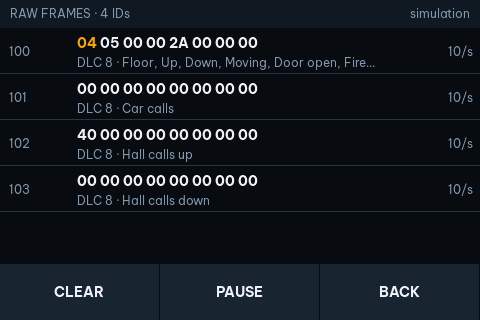 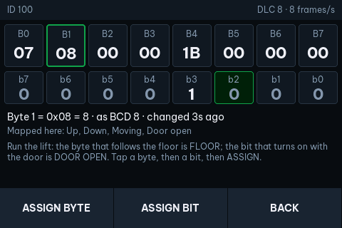 </p>

## Fuji hall-call bus — the default map

Decoded at the lift (2026-10-17) with the raw capture and three trips — 3→5 up
(hall up at 5), 5→1 down (hall down at 5, car call 1), 1→5 up (hall up at 1, car
call 5). **CAN 2.0A at 27.78 kbit/s** (36 µs bit — not a standard rate, which is
why no table rate ever gave a frame), about 85 frames/s.

| ID | Rate | Content |
|---|---|---|
| `030` | 10/s | B0: bit 7 up · bit 6 down · bit 5 running · bit 4 levelling · bit 3 door **closed** · bits 0–2 always on so far. B7: car position, **lowest floor = 3**. B4 bit 4: in the door zone. B3 bit 7: on ~2 min after the last trip (standby?) |
| `033` | 10/s | car calls, bitmap from B0 bit 0 = lowest floor |
| `034` | 10/s | hall calls up, same bitmap |
| `035` | 10/s | hall calls down — **assumed** (the down call seen was answered at once, nothing registered) |
| `037` | 10/s | B3 bit 1 / bit 0: arrival lantern up / down |
| `07C` | 5/s | car-top board: B0 bit 1 **door-open button** · bit 0 **door-close button** (held while pressed) · B1 bit 7 door fully open · bit 6 door fully closed |
| `07D` | on press | car button pressed, bitmap (then `00` when released) |
| `640`+n / `6C0`+n | on press | hall button up / down at floor n+1, B0 = that floor's bit |
| `031` | 10/s | controller clock, multiplexed by B7 |
| `545` | 10/s | B6 speed (0 → 0x52 and back on a trip), B0 levelling sensors |
| `404` | 10/s | controller info pages (one is ASCII `MU_V51`) |

The **FUJI** preset (MENU › PROTOCOL › FUJI, `/cfg` LOAD FUJI, console `preset fuji`)
maps floor, arrows, running, door and the three call bitmaps, and sends calls the
way the buttons do: car call on `07D`, hall calls on `640`+floor / `6C0`+floor
(command options *ID + floor* and *Release*: the frame again without the bit 250 ms
later). **Door open / close / hold** mirror the car-top frame `07C`: right after
each real `07C` the display sends the same frame with the button bit set (option
*Mirror*) — 2 frames = a short press, 75 frames = the open button held 15 s — so the
door-limit bits stay what the board itself reported. Door commands are refused while
the car moves; a hold stops at once if the car starts or the lift leaves normal
service. Tested on site 2026-10-18: open reacts in 0.7 s, close 1.2 s, hold kept
the door open 16 s. Not identified yet: fire service, inspection, faults, load.

## CiA 417 (CANopen-Lift)

A fresh board starts with the **Fuji map at 27.78 kbit/s** (above), listen-only;
updating from an older firmware switches a board in use to that rate once, and
to the Fuji map and 6 floors when no signal was mapped. MENU › PROTOCOL ›
**CiA 417** switches to the built-in CANopen-Lift decoder (CiA 417 normally runs
at 250 kbit/s: set it on the CAN screen). The
signal map is empty and still applies on top, so a maker's extra frames found
with the debugger can be added without losing the CiA 417 part.

What is decoded (lift *L* = 1–8, set on `/cfg`):

| CAN-ID | From → to | Used for |
|---|---|---|
| `0x700`+node | every device, 1 s | heartbeat — node list on the debug page and MENU › PROTOCOL; hearing them = link OK |
| `0x400`+L−1 | call controller → all panels | 6-byte record: function · sub-function · lift bit mask · floor · door · data (bit 0 = on). `40h` position (floor lamp on) · `42h` arrow up/down · `02h` hall call acknowledged (sub 1 up, 2 down) · `05h` car call acknowledged |
| `0x480`+node | panel → call controller | call requests — counted; **the display sends its calls here** (node-ID default 120 → `0x4F8`): record on, 250 ms later off, like a button |
| `0x500`+node | MPDO, destination address | object writes to the panels: `62B0h` text position indication (ASCII → floor label), `6218h` position indication |
| `0x183` | car drive → controller | statusword · mode · velocity actual — moving, and the arrow when the controller sends no direction records |
| `0x182` · `0x18C` | controller → drive · position unit | drive command, car position value (shown in the console) |
| `0x080`+node | emergency | last code shown in the console; not used as a lift fault |

Where it comes from, honestly: the CiA 417-3 PDO tables are not public. The
record layout, function codes and the `0x400`/`0x480` IDs follow the
Apache-2.0 [CANoopEn](https://github.com/xyntos-ch/CANoopEn) stack (Xyntos);
the drive IDs follow the WEG ADL300 CiA 417 manual (lift 1). **Not verified**:
which byte of a position record carries the floor (the floor byte is used,
the sub-function when the floor byte is `FFh`); the drive IDs for lifts 2–8
(assumed 16 IDs further per lift); the floor numbering (lowest floor = 1 by
default — MENU › FLOORS › *bus value of lowest*). Door state, load and special
indications are not decoded (their IDs are not public) — map them from the
debugger if needed. Door open/close commands need the map as well.

Is it CiA 417? Open `/debug`: the **CANopen nodes** box lists every
heartbeat. None at 250 kbit/s with a clean bus = not CANopen at that rate —
use *Measure bit timing* / *Detect bit rate*. The ID table names every
CANopen ID next to its bytes.

MENU › PROTOCOL › **CiA 417** switches back to it; console `preset cia417`,
`co lift|node|base <n>`. MENU › SIMULATION speaks CiA 417 while it is the
protocol (heartbeats of nodes 1 and 2, drive status, records on change).

## EVL-CAN — the project's reference protocol

For home-built controllers, protocol gateways (e.g. a second ESP32 translating
RS-485/Modbus to CAN) and the simulator. 11-bit IDs, any bit rate (default
125 kbit/s). Status frames 10 times a second.

| ID | Dir | Bytes |
|---|---|---|
| `0x100` | lift → display | B0 floor (lowest = 1) · B1 bit0 up, bit1 down, bit2 moving, bit3 door open · B2 bit0 fire service, bit1 inspection, bit2 overload, bit3 out of service · B3 fault code (0 = none) · B4 load % · B5–B7 0 |
| `0x101` | lift → display | car-call bitmap, bit 0 = lowest floor (8 bytes = 64 floors) |
| `0x102` | lift → display | hall-call-up bitmap |
| `0x103` | lift → display | hall-call-down bitmap |
| `0x180` | display → lift | B0 command: 1 car call, 2 hall up, 3 hall down, 4 door open, 5 door close · B1 floor (lowest = 1) |

MENU › PROTOCOL › EVL-CAN loads this map (and leaves CiA 417). MENU › SIMULATION runs a virtual
lift that speaks EVL-CAN (CiA 417 while that is the protocol): it moves, opens doors, invents hall calls, answers
the panel's calls — and **detaches the display from the real bus** while on.

## Audio announcements

GPIO 26 is the ESP32's DAC2 and drives the board's speaker amplifier, so the
display plays real audio. Playback has **its own task and its own server on
port 81**: the body is read from the socket while it plays and goes straight to
the I2S DMA, so an announcement of any length streams without buffering and
without stalling the CAN path or the screen.

```bash
# send a WAV (PCM 8/16-bit, mono or stereo, 8–48 kHz); chime=1 plays a ding-dong first
curl --data-binary @message.wav "http://<ip>:81/play?chime=1&vol=8"
# raw PCM instead of WAV
curl --data-binary @msg.raw "http://<ip>:81/play?rate=16000&bits=16&ch=1"
# let the display fetch the file itself
curl "http://<ip>:81/play?url=http://192.168.31.10:8123/local/announce.wav&chime=1"
# controls on the normal web port
curl -X POST "http://<ip>/api/audio/stop"
curl "http://<ip>/api/audio"            # {"busy":false,"enabled":true,"played":3,"port":81,"last":"played 2140 ms"}
```

- Formats: **WAV PCM** and raw PCM. MP3 is not decoded (Home Assistant's Piper
  TTS produces WAV; cloud TTS engines usually give MP3).
- `vol` = 1–10 (2 dB per step), default the SOUND volume. The pin is ramped
  over 20 ms at start and end, so there is no click.
- A new announcement replaces the one playing. Beeps and the arrival chime are
  muted while an announcement plays. The main screen shows "· ANNOUNCEMENT".
- Turn the API off in MENU › SOUND › Announcements (default on).
- `audiotest` on the serial console plays a ding-dong and four notes through
  the same path — no network needed.

```yaml
# Home Assistant: announce a WAV that HA serves from /config/www
rest_command:
  lift_announce:
    url: "http://LIFT_IP:81/play?url=http://HA_IP:8123/local/{{ file }}&chime=1"
    method: GET
```

## MQTT and Home Assistant

MENU › HA · MQTT: broker `host:port`, user, password. Needs the site WiFi
(MENU › NETWORK). Uses the esp-mqtt client built into the ESP32 core: it runs
in its own task, so a dead broker never stalls the display (PubSubClient's
blocking `connect()` would).

Base topic `elevator/<last 3 MAC bytes>`:

| Topic | Content |
|---|---|
| `…/avail` | `online` / `offline` (LWT, retained) |
| `…/state` | retained JSON, on every change (≤ 4/s) + every 30 s: `{"floor":"5","idx":4,"dir":"up","moving":true,"door":false,"fault":0,"mode":"normal","fire":false,"load":40,"link":true,"fps":40,"rssi":-61,"sim":false,"car_calls":"…"}` |
| `…/cmd/car` · `…/cmd/up` · `…/cmd/dn` | floor label (`"5"`, `"B1"`) or index (`"#4"`) |
| `…/cmd/door` | `open` / `close` |
| `…/announce` | URL of a WAV to play (`http://…`, add `chime=1` anywhere for the ding-dong) or `stop` |
| `…/cmd_result` | `{"cmd":"car","floor":"5","ok":false,"msg":"remote commands are OFF"}` |

Discovered entities (device "LIFT A"): Floor, Direction, Door, Moving, Fault,
Fault code, Mode, Fire service, Load (only if mapped), CAN signal, CAN frames
per second, WiFi signal — plus **Car call / Hall call up / Hall call down**
selects and **Door open / Door close** buttons, which exist only while remote
commands are allowed on the panel. Discovery is re-sent when HA restarts
(`homeassistant/status`), when floors are renamed and when that switch changes.

```yaml
# Example: tell me when the lift faults or goes into fire service
automation:
  - alias: Lift problem
    trigger:
      - platform: state
        entity_id: binary_sensor.lift_a_fault
        to: "on"
      - platform: state
        entity_id: binary_sensor.lift_a_fire_service
        to: "on"
    action:
      - service: notify.notify
        data:
          message: "Lift A: {{ states('sensor.lift_a_mode') }}, code {{ states('sensor.lift_a_fault_code') }}"
```

## Web pages

`http://<ip>/` — live status (1 s), call buttons, recent events.
`http://<ip>/cfg` — settings, unlocked with the technician code (5 wrong
codes → locked 60 s, +60 s per further miss): lift name, floors and labels,
bit rate, the full protocol map and command templates, MQTT, WiFi, display,
sound, code change, log CSV. With no WiFi configured, or when joining fails
four times, the display starts its own access point **LIFT-DISPLAY /
liftdisplay** at `http://192.168.4.1/` — and **keeps trying the network every
30 s** (not while someone is connected to the AP). As soon as the network is
back the AP is switched **off** (logged: "WiFi lost -> own AP on" / "WiFi back
-> own AP off"). Before, a router reboot left the display stuck in AP mode.

API: `GET /api/state`, `GET /api/log`, `GET /log.csv`, `POST /api/login`,
`POST /api/cmd`, `GET|POST /api/cfg|set|map` (token from login).
Public, read only: `GET /api/can/stream` (live frames, SSE), `/api/can/probe`
(bit timing), `/api/can/raw?ms=50` (logic-analyzer capture), `/api/can/errors`
(controller error report), `/api/screen` (the panel as a 480×320 BMP; `?show=menu`
switches the panel to a screen first — display only). A screenshot holds the main
loop for a second or two: CAN frames that arrive meanwhile are dropped (the lift
repeats its status 10 times a second, so the display catches up at once).
Firmware over WiFi: `powershell -File firmware/tools/ota_upload.ps1` or the
*Firmware update* section of `/cfg`.

## Serial console (115200)

| Command | Does |
|---|---|
| `?` | lift state, CAN counters, command state, heap, slowest loop |
| `sim` · `sim fire 1` · `sim fault 30` · `sim over 1` · `sim insp 1` · `sim oos 1` | simulator on/off and incidents |
| `inj 100 0501000000` | feed one frame as if received |
| `tx 180 0105` | raw transmit (needs ACK mode + commands on) |
| `kbps 250` · `mode listen\|ack` · `txen 0\|1` · `remote 0\|1` · `autobaud` | CAN |
| `call 5` · `up B1` · `dn #3` · `open` · `close` | commands (same locks as the panel) |
| `map` · `preset cia417\|evl\|clear` · `sig <n> <id> <byte> <mask> [enc] [offset] [inv]` | protocol map (`map` also prints what the CiA 417 decoder heard) |
| `co lift 1` · `co node 120` · `co base 1` | CiA 417: lift number, our node-ID for calls, bus floor number of the lowest floor |
| `floors 12` · `label 0 B2` · `offset 1` · `autolabel` | floors |
| `wifi <ssid> <pass>` · `wifi off` · `wifi clear` · `net` | network (password is never echoed) |
| `mqtt <host> [port]` · `mqtt user <u> <p>` · `mqtt on\|off` | MQTT |
| `audiotest` · `play http://…/file.wav` | speaker test · fetch and play |
| `led 0|1` | status LED off / on |
| `touch 0|1` | touch screen off / on — off: the panel ignores every touch (MENU › DISPLAY › DISABLE TOUCH; back on from `/cfg` › Display or here) |
| `log` · `csv` · `mem` · `nvs` | log and memory |
| `s <n>` · `dump` · `shot` · `click <n>` · `deep <n>` · `cal` · `stress <n>` | UI testing |
| `factory` | erase settings, map, labels and log (keeps WiFi/MQTT and touch calibration) |

## Build and flash

```bash
cd firmware && ~/.platformio/penv/Scripts/pio.exe run -t upload
```

USB: the board's CH340 port (COM8 here — set `upload_port` in `platformio.ini`).
Over WiFi, once the board runs this firmware:

```bash
powershell -ExecutionPolicy Bypass -File firmware/tools/ota_upload.ps1 -Ip 192.168.31.16
```

It asks for the technician code (or reads it from `firmware/ota_code.txt`, which
git ignores), uploads `.pio/build/lift/firmware.bin` into the spare OTA slot and
the display restarts into it; a broken upload leaves the running firmware alone.
`pio run -e lift_ota -t upload` (espota) works too, with the code in `upload_flags`.

Fonts are generated from Be Vietnam Pro and Material Icons:
`bash tools/build_fonts.sh` (needs Node.js).

Partitions (4 MB): two 1.875 MB app slots for OTA, otadata at the standard 0xE000
(a USB upload always boots the new image), 128 KB NVS. Settings, protocol map,
labels, log, WiFi and touch calibration survive firmware updates.

## Tested on the board

| Test | Result |
|---|---|
| Boot, fresh NVS | clean, no `[E]` lines, 225 KB heap free |
| Simulator: call, travel, door cycle, fire service, fault 30, overload, inspection | correct display and log; calls refused in fire service |
| Every screen built, `dump` of widget coordinates | nothing outside 480×320 (except rows inside scroll lists) |
| `stress 30` — 180 screen rebuilds | heap before 236 984, after 236 984: **0 bytes** difference |
| Random taps with the simulator running: 300 on the first layout, 400 on the current one | 0 panics, 0 restarts; 21 calls/door commands went to the virtual lift in the first run |

Bugs found during bring-up on the board, all fixed:

| Bug | Effect |
|---|---|
| Arrow animation divided by the widget height | LVGL reports height 0 until its first layout pass → **integer divide by zero, reboot** right after the indicator was rebuilt |
| Link timeout used a `now` taken before the simulator emitted frames | unsigned `now - lastAt` underflowed to ~49 days → link flapped lost/OK and the floor showed `--` |
| Every log entry pushed the NVS write 1.2 s further | a steady stream of events postponed the flash write **forever**; a power cut would lose all of it. The deadline is now fixed by the first change |
| Per-ID rates not updated while the CAN driver is detached | RAW FRAMES showed 0/s in simulation |

## Weather on the main screen

After the clock: a condition icon (WMO code → sun / night / cloud / fog / drizzle /
rain / storm / snow, coloured) and the temperature. Source: [Open-Meteo](https://open-meteo.com)
(free, no key), plain HTTP, every 15 min in its own task (a failed fetch retries in
2 min; a reading older than an hour is hidden). Location: `/cfg` › Display ›
*Weather location* (latitude / longitude), or 0 / 0 = found once from the internet
address (ip-api.com, city level). `/api/state` reports it as `"wx":{"t":28.4,"code":3,"day":0}`.

## Running 24/7

| Guard | What it does |
|---|---|
| Loop watchdog | `loop()` not coming round for 30 s (a hang anywhere) → restart. Firmware upload, espota, touch calibration and screenshots feed it. |
| Reset reason in the log | every start is logged as "Power up · power on / restart / CRASH / WATCHDOG / BROWNOUT (power dip)" — look here first when the display restarted by itself |
| WiFi | retried for ever; own AP only while the network is unreachable (above) |
| MQTT, NTP | esp-mqtt reconnects by itself; SNTP re-syncs hourly |
| CAN | fallback and bus-off guard with automatic re-arm (Safety design, point 3) |
| Memory guard | free heap < 24 KB or largest block < 10 KB for a minute → logged, planned restart while the car is not moving |
| Flash wear | settings, map and log are written only when changed, batched (one write per change burst) |

## Known limitations

- Not yet tested against an MQTT broker; fire service, inspection, faults and
  load are not yet identified on the Fuji bus (see Status).
- 12.5, 16 and 20 kbit/s need BRP > 128: the driver sets the chip's BRP_DIV
  bit itself, which only exists on ESP32 rev 2+ (this board: rev 3.1). On an
  older chip those rates are refused.
- The TWAI ISR is not in IRAM in the prebuilt core: during an NVS write (a few
  ms, only when settings or the log change) the hardware FIFO can overflow and
  drop a frame or two. Status frames repeat, so the display does not notice.
- No battery-backed clock (pin 22 went to CAN): time comes from NTP; without a
  network, log entries are marked `?` with seconds since boot.
- Floor labels are limited to 3 characters A–Z, 0–9 and `-` (the giant fonts
  only contain those glyphs).

## Layout

```
firmware/
  platformio.ini, partitions_elevator.csv, include/lv_conf.h, include/lv_assert_hook.h
  src/config.h        pins, limits, signal / command / mode enums
  src/drv_can.cpp     TWAI driver: listen-only, arming, fallback, detection, frame table
  src/lift.cpp        protocol map → lift state, commands and their locks, log, chime, simulator
  src/store.cpp       NVS: settings, protocol map, labels, event log
  src/drv_net.cpp     WiFi, access point fallback, NTP, web pages and API
  src/drv_mqtt.cpp    esp-mqtt client, Home Assistant discovery
  src/drv_display.cpp ST7796 + touch + LVGL + dimming + screenshot readback
  src/drv_io.cpp      RGB LED, chime, clock
  src/drv_audio.cpp   announcements: port-81 server task, WAV/PCM streaming → I2S built-in DAC
  src/drv_candebug.cpp live CAN stream for /debug (port 82 task)
  src/drv_weather.cpp Open-Meteo weather task
  src/web_debug.h     the /debug page (frames, recorder, logic analyzer, control)
  src/ui.cpp          all screens
  src/main.cpp        setup, loop, serial console
  tools/build_fonts.sh   fonts (Be Vietnam Pro, Material Icons) → src/fonts/
  tools/ota_upload.ps1   firmware update over WiFi (asks for the technician code)
docs/screens/         screenshots read back from the panel (GET /api/screen)
docs/home-assistant-homekit.md   MQTT broker, HA scripts, HomeKit Bridge
```
